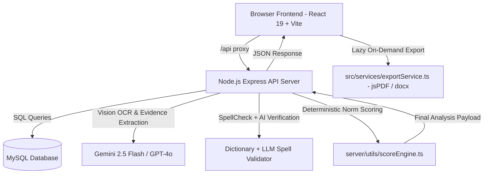

# GraphiaCheck System Architecture & Technical Specifications

## 1. High-Level System Overview

GraphiaCheck is built as a high-performance, clinically grounded full-stack application for handwriting analysis, OCR transcription, diagnostic scoring, and multi-page medical/educational report generation.



---

## 2. Technology Stack

- **Frontend Core:** React 19, TypeScript, Vite 6, Tailwind CSS v4.
- **Routing & State:** `react-router-dom` v7 with `React.lazy` route code-splitting.
- **Motion & UI:** `framer-motion` (motion/react), `lucide-react`, `react-image-crop`.
- **Backend API:** Node.js, Express, TypeScript (`tsx`).
- **Database:** MySQL 8 with connection pooling and auto-schema initialization (`mysql2/promise`).
- **AI Models:** Gemini 2.5 Flash / GPT-4o Vision API with automatic fallback mechanisms.
- **Export Engines:** `modern-screenshot` (DOM capture), `jspdf` (PDF generation), `docx` (Word document generation), `file-saver`.

---

## 3. Frontend Architecture

### 3.1 Route-Level Code Splitting (`src/Root.tsx`)
To ensure near-instant initial page loads, all routes are dynamically loaded via `React.lazy()` with `<Suspense fallback={<PageFallback />}>`:
- **Landing Page (`/`):** Loaded on demand (`HomePage.tsx`), bundle size: **~9.95 KB**.
- **Auth Page (`/auth`):** Loaded on demand (`AuthPage.tsx`), bundle size: **~5.04 KB**.
- **Static Legal Pages (`/about`, `/terms`, `/privacy`, `/refund`):** Individual lazy chunks (8–22 KB).
- **Admin Panel (`/admin`):** Isolated lazy chunk (**20 KB**).
- **Core App (`/app`):** Loaded only when authenticated or in report preview mode (**172 KB**).

### 3.2 Decoupled Export Service (`src/services/exportService.ts`)
Previously, heavy client-side document generators (`jspdf`, `docx`, `file-saver`) were statically imported in `App.tsx`, causing over 600 KB of bloat on first paint.
- **Modern Pattern:** Dedicated service `exportService.ts` that dynamically imports libraries on demand:
  ```typescript
  export async function exportReportAsPdf(reportElement: HTMLElement, fileName?: string): Promise<void> {
    const { jsPDF } = await import('jspdf');
    // ...
  }

  export async function exportReportAsWord(options: ExportWordOptions): Promise<void> {
    const { Document, Packer, Paragraph, TextRun, Table, TableRow, TableCell, ImageRun, AlignmentType, BorderStyle, WidthType, HeadingLevel } = await import('docx');
    const { saveAs } = await import('file-saver');
    // ...
  }
  ```
- **Benefit:** `jspdf` (~390 KB) and `docx` (~500 KB) are isolated into separate chunks that only download when the user clicks "Save as PDF" or "Save as Word".

### 3.3 Reusable Transcription Engine (`src/components/RenderTranscription.tsx`)
- Isolated from `App.tsx` into a standalone, memoized component (`React.memo`).
- Token processing and error classification (spelling, grammar, punctuation, confirmed cancellations) are wrapped in `useMemo(() => processTokens(text, highlightMap), [text, highlightMap])`.
- Avoids re-tokenizing text on unrelated state changes (like typing student name, moving sliders, or expanding drawers).

### 3.4 Vite Manual Chunking (`vite.config.ts`)
Configured `rollupOptions.output.manualChunks` to optimize HTTP cache reuse:
- `vendor-react`: `react`, `react-dom`, `react-router-dom`
- `vendor-motion`: `motion`, `framer-motion`
- `vendor-icons`: `lucide-react`

---

## 4. Backend Processing Pipeline (`analyzeController.ts`)

The backend processes images in an evidence-driven, deterministic 3-pass pipeline:

1. **Pass 1: Vision Evidence Extraction**
   - Extracts verbatim transcription with inline `[CANCELLED: word]` and `[MAYBE-CANCELLED: word]` tags.
   - Extracts handwriting visual observations: Letter formation, alignment, spatial organization, line quality.
   - Parallel Pass 1b: Second-look focused strike-through check to catch subtle pencil cross-outs.
2. **Pass 2: Spelling & Grammar Verification**
   - Word tokenization filtered against student cancellations (cancelled words are never flagged as errors).
   - Spell checking via dictionary check + GPT validation to prevent false positives on names, proper nouns, and hyphenated words.
3. **Pass 3: Deterministic Score Calculation (`scoreEngine.ts`)**
   - Calculates numerical scores (0–100) using established grade-level norms.
   - Incorporates Response to Intervention (RTI) history.
   - Computes Basal Grade, Ceiling Grade, and Overall Probability (LOW / MODERATE / HIGH).
4. **Pass 4: Narrative Synthesis**
   - Generates multi-section clinical text report.
   - Attaches deterministic summary block and stores report record in MySQL database.

---

## 5. Report Layout Standard (3-Page Fixed Format)

The report rendered in `App.tsx` is strictly structured across **3 A4 pages** (`210mm × 297mm` each):
- **Page 1:** Header Banner, Timing Record, Writing Sample Details, Original Handwriting Sample Image, Verbatim OCR Transcription, Domain Scores (7 cards).
- **Page 2:** Top Minimal Header, Recommendation & Probability cards, Basal & Ceiling Level cards, Written Language Skills Diagnostic Table (Sentence Boundaries, Grammar, Past Tense), Academic Discrepancy Analysis, Spelling Patterns & Grade Level Discrepancies (4 cards).
- **Page 3:** Top Minimal Header, Handwriting Mechanics & Geometric Elements (7 points), Fluency Analysis (4 cards + formula calculation), Clinical Interpretation & Next Steps (Assessment Recommendation + Probability Estimate), Actionable Strategies (Top 3 clinical recommendations), Confidentiality Disclaimer footer.
